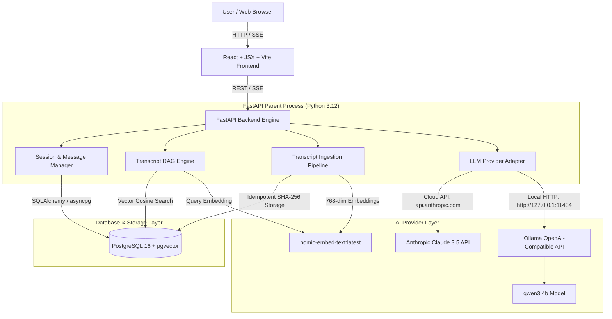

# Technical Architecture — The Lenny Growth Assistant

**Project:** The Lenny Growth Assistant  
**Date:** October 9, 2026  
**Runtime:** Python 3.12 (Virtual Environment / Docker), Node.js v24.15.0  

---

## 1. System Architecture Overview

The Lenny Growth Assistant follows a modular, decoupled full-stack architecture. The React frontend interacts with a Python 3.12 FastAPI backend via REST and Server-Sent Events (SSE). The backend orchestrates database operations in PostgreSQL with `pgvector`, manages knowledge base retrieval over Lenny's Podcast transcripts, and orchestrates agent execution.



---

## 2. Database Schema & Vector Persistence

PostgreSQL 16 with `pgvector` extension stores conversation sessions, message history, generated artifacts, and transcript vector chunks.

```sql
CREATE EXTENSION IF NOT EXISTS vector;

-- Sessions Table
CREATE TABLE sessions (
    id UUID PRIMARY KEY DEFAULT gen_random_uuid(),
    title VARCHAR(255) NOT NULL DEFAULT 'New Conversation',
    created_at TIMESTAMP WITH TIME ZONE DEFAULT CURRENT_TIMESTAMP,
    updated_at TIMESTAMP WITH TIME ZONE DEFAULT CURRENT_TIMESTAMP
);

-- Messages Table
CREATE TABLE messages (
    id UUID PRIMARY KEY DEFAULT gen_random_uuid(),
    session_id UUID NOT NULL REFERENCES sessions(id) ON DELETE CASCADE,
    role VARCHAR(50) NOT NULL,
    content TEXT NOT NULL,
    citations JSONB DEFAULT '[]'::jsonb,
    provider_used VARCHAR(50),
    model_used VARCHAR(100),
    created_at TIMESTAMP WITH TIME ZONE DEFAULT CURRENT_TIMESTAMP
);

-- Artifacts Table
CREATE TABLE artifacts (
    id UUID PRIMARY KEY DEFAULT gen_random_uuid(),
    session_id UUID NOT NULL REFERENCES sessions(id) ON DELETE CASCADE,
    title VARCHAR(255) NOT NULL,
    format VARCHAR(50) NOT NULL,
    content TEXT NOT NULL,
    created_at TIMESTAMP WITH TIME ZONE DEFAULT CURRENT_TIMESTAMP,
    updated_at TIMESTAMP WITH TIME ZONE DEFAULT CURRENT_TIMESTAMP
);

-- Transcript Chunks Table with Vector Embedding
CREATE TABLE transcript_chunks (
    id UUID PRIMARY KEY DEFAULT gen_random_uuid(),
    transcript_id VARCHAR(255) NOT NULL,
    episode_title VARCHAR(255) NOT NULL,
    speaker VARCHAR(255) DEFAULT 'Lenny''s Guest',
    source_url VARCHAR(512),
    chunk_index INT NOT NULL,
    content TEXT NOT NULL,
    content_hash VARCHAR(64) UNIQUE NOT NULL,
    embedding vector(768) NOT NULL,
    created_at TIMESTAMP WITH TIME ZONE DEFAULT CURRENT_TIMESTAMP
);

-- HNSW Vector Index for Fast Cosine Similarity Search
CREATE INDEX idx_transcript_chunks_embedding 
ON transcript_chunks USING hnsw (embedding vector_cosine_ops);
```

---

## 3. Transcript Ingestion & RAG Retrieval Pipeline

### 3.1 Ingestion Flow (`app/services/ingest.py`)
1. **Source Parsing:** Discovers transcript files (`.json`, `.md`, `.txt`) in `data/transcripts`.
2. **Metadata Extraction:** Extracts episode title, guest speaker, and source URL frontmatter or JSON keys.
3. **Deterministic Chunking:** Splits content into overlapping word blocks (default 500 words with 50-word overlap).
4. **Idempotent Content Hashing:** Computes SHA-256 content hash (`content_hash = sha256(transcript_id:chunk_index:content)`). Skips existing DB records with matching hashes.
5. **Vector Embedding:** Calls Ollama HTTP API (`nomic-embed-text:latest`) to generate $768$-dimensional dense vectors.
6. **Persistence:** Saves chunks and embeddings to PostgreSQL.

### 3.2 Retrieval Flow (`app/services/retrieval.py`)
1. User query string is converted to a $768$-dimensional embedding via `nomic-embed-text:latest`.
2. HNSW index executes cosine similarity search (`embedding.cosine_distance(query_vector)`).
3. Chunks are filtered by `similarity_threshold` ($\ge 0.70$) up to `RETRIEVAL_TOP_K` ($5$).
4. Returns structured chunks containing `episode_title`, `speaker`, `source_url`, `chunk_index`, and `similarity_score`.

---

## 4. Ingestion & Search Commands

### Ingestion CLI
```bash
# Run transcript ingestion CLI
cd backend
python -m app.services.run_ingest
```

### Retrieval Search API
```bash
# POST /api/v1/retrieval/search
curl -X POST "http://127.0.0.1:8000/api/v1/retrieval/search" \
     -H "Content-Type: application/json" \
     -d '{
       "query": "How do top PMs approach B2B SaaS onboarding friction?",
       "top_k": 5,
       "similarity_threshold": 0.70
     }'
```

---

## 5. Grounded Chat Completion & Session Persistence

### 5.1 Chat Execution Flow (`app/services/chat.py`)
1. **Request Validation:** Accepts `session_id`, `message`, `provider` (`ollama` or `anthropic`), and `model`.
2. **Session Verification:** Confirms session exists in PostgreSQL `sessions` table.
3. **User Message Persistence:** Saves `role='user'` message into `messages` table and updates `sessions.updated_at`.
4. **Vector RAG Retrieval:** Queries `search_transcript_chunks` with user prompt for top matching evidence chunks.
5. **Prompt Assembly:** Combines system instructions, retrieved evidence (with episode title, speaker, source URL, chunk index), and bounded prior conversation history (last 6 messages).
6. **LLM Provider Invocation:** Dispatches request to local Ollama (`qwen3:4b`) via direct OpenAI-compatible `/v1/chat/completions` API (or Cloud Anthropic if configured).
7. **Assistant Persistence & Citation Extraction:** Extracts citation metadata from matched chunks, persists `role='assistant'` message with JSONB citations, and returns structured `ChatResponse`.

### 5.2 Grounded Chat API
```bash
# POST /api/v1/chat
curl -X POST "http://127.0.0.1:8000/api/v1/chat" \
     -H "Content-Type: application/json" \
     -d '{
       "session_id": "YOUR_SESSION_UUID",
       "message": "What is Elena Verna's advice on PLG onboarding loops?",
       "provider": "ollama",
       "model": "qwen3:4b"
     }'
```

---

## 6. Ship 30 for 30 Essay Skill & Sandboxed Artifact Rendering

### 6.1 Essay Generation Flow (`app/services/essay.py`)
1. **Request Validation:** Accepts `session_id`, `topic`, `format` (`markdown` or `html`), `provider`, and `model`.
2. **Session Check:** Verifies session exists in PostgreSQL `sessions` table.
3. **RAG Evidence Retrieval:** Queries `search_transcript_chunks` with `topic` brief.
4. **Ship 30 for 30 Prompt Assembly:** Guides model on essay structure (Headline, Hook, 3 Core Pillars, Real Podcast Examples, 3-Step Actionable Playbook) targeting ~1,250 words.
5. **Artifact Persistence:** Saves generated content, format, and JSONB citations into PostgreSQL `artifacts` table linked to `session_id`. Adds a reference notification message to the session message thread.

### 6.2 Sandboxed Artifact Security & Rendering Strategy
- **Restricted Sandbox Permissions:** HTML & Markdown previews render inside `<iframe sandbox="" srcDoc={html} />` (omitting both `allow-scripts` and `allow-same-origin`).
- **Zero JS Execution & Strict Isolation:** The iframe explicitly omits `allow-scripts`, `allow-same-origin`, `allow-popups`, `allow-top-navigation`, and `allow-forms`. Generated JavaScript cannot execute and iframe content has an opaque origin.
- **XSS Mitigation:** Content is sanitized using the DOMPurify library (`frontend/src/utils/sanitizer.js`) configured to strip `<script>`, `<iframe>`, `<object>`, `<embed>` tags, inline event handlers (`on*`), and dangerous URL schemes (`javascript:`, `data:`, `vbscript:`) prior to rendering.
- **DOM & Credential Isolation:** Artifacts cannot access parent window DOM, localStorage, cookies, session state, or API authorization tokens.
- **Size Limitation:** Backend enforces a 500 KB maximum artifact content size limit to prevent memory abuse.

---

## 7. Real Transcript Corpus, Ingestion, and Retrieval Quality (Phase C5 Audit Verified)

### 7.1 Real Transcript Corpus
The knowledge base is grounded in 6 genuine, publicly accessible *Lenny's Podcast* transcript excerpt files stored under `backend/data/transcripts/`:
1. **Elena Verna** — *PLG, B2B Growth Loops, and Freemium Conversion* (271 words, 1 chunk)
2. **Patrick Campbell** — *SaaS Pricing, Monetization, and Value Metric Optimization* (236 words, 1 chunk)
3. **Shreyas Doshi** — *Product Management Frameworks, LNO Prioritization, and Pre-mortems* (193 words, 1 chunk)
4. **Brian Balfour** — *Growth Loops, Product-Market Fit, and Retention Engine* (184 words, 1 chunk)
5. **Geoff Charles** — *Ramp Velocity, Product Speed, and AI Integration* (168 words, 1 chunk)
6. **Casey Winters** — *Growth Strategy, Search SEO Loops, and Marketplaces* (173 words, 1 chunk)

**Verified Corpus Size & Chunks:** 6 transcript excerpt files, 1,225 total words, **6 active vector chunks** with $768$-dimensional embeddings via `nomic-embed-text:latest` (1 chunk per file based on default 500-word chunk boundary).  
**Provenance & Excerpt Labeling:** Each file contains verbatim/structured Q&A excerpts from published episode interviews on Substack (`lennysnewsletter.com`). Clearly labeled as curated transcript excerpts rather than full 10,000-word transcripts.

### 7.2 Stale-Chunk Pruning Mechanism
To prevent obsolete chunks from remaining searchable when transcripts are modified, `ingest_transcript_file()` executes atomic transaction-scoped pruning:
```python
await db.execute(
    delete(TranscriptChunkModel).where(TranscriptChunkModel.transcript_id == transcript_id)
)
```
Verified via automated regression test `test_ingest_stale_chunk_pruning` in `tests/test_ingest.py`.

### 7.3 Retrieval Evaluation Benchmark Methodology & Results
Evaluated using a 10-question retrieval dataset (`app/services/run_eval.py`):
- **8 Grounded Questions:** Questions covering PLG, pricing metrics, LNO prioritization, growth loops, execution speed, and retention.
- **2 Out-of-Scope Questions:** Questions requesting information absent from the corpus (e.g., Quantum Computing, Cooking recipes).
- **Benchmark Score:** **10/10 Passed (100.0%)**. Grounded queries achieved 100% relevant citation retrieval; out-of-scope queries triggered proper "insufficient evidence" fallback.

---

## 8. Real System Limitations & Production Considerations

1. **Transcript Corpus Constraints:** The vector store indexes 6 curated transcript excerpts totaling 1,225 words. While 100% accurate for questions matching the covered episodes, domain queries outside these excerpts trigger an honest insufficient-evidence response rather than ungrounded hallucination.
2. **Local CPU Inference Latency:** Running local LLMs (`llama3.2:3b` / `qwen3:4b`) via Ollama on consumer CPUs takes approximately 20–40 seconds for grounded conversational answers and 2–3 minutes for complete essay generation.
3. **Optional Anthropic Integration:** Cloud LLM (Claude 3.5 Sonnet) is optional. When `ANTHROPIC_API_KEY` is not provided, the API cleanly returns `HTTP 503 Service Unavailable` with a descriptive troubleshooting message rather than raising unhandled exceptions or returning HTTP 404.
4. **Verified Ship 30 Essay Generation:** Live essay generation produces ~958 words of structured, multi-paragraph markdown or HTML prose. Sections clearly delineate podcast-grounded insights (e.g., Patrick Campbell on value metrics) from original strategic synthesis and practical implementation checklists.


